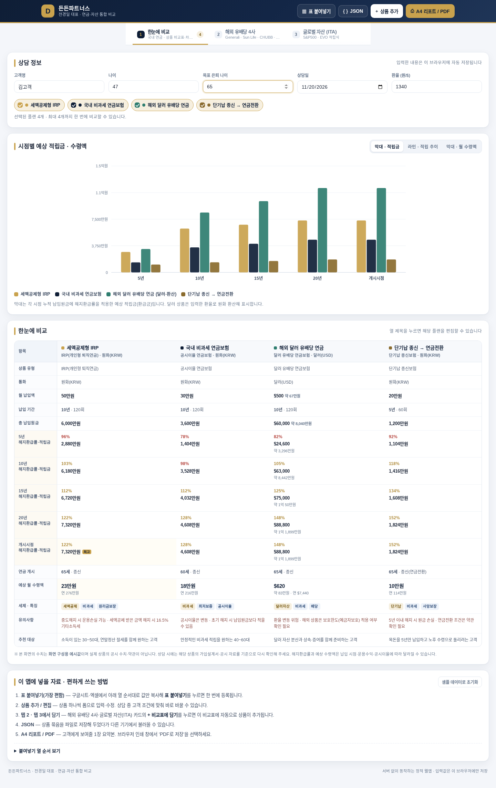
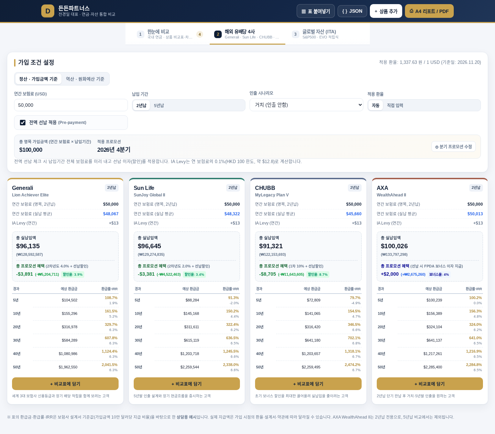
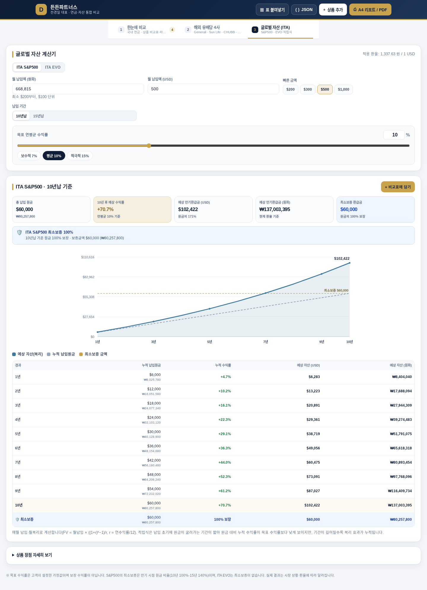
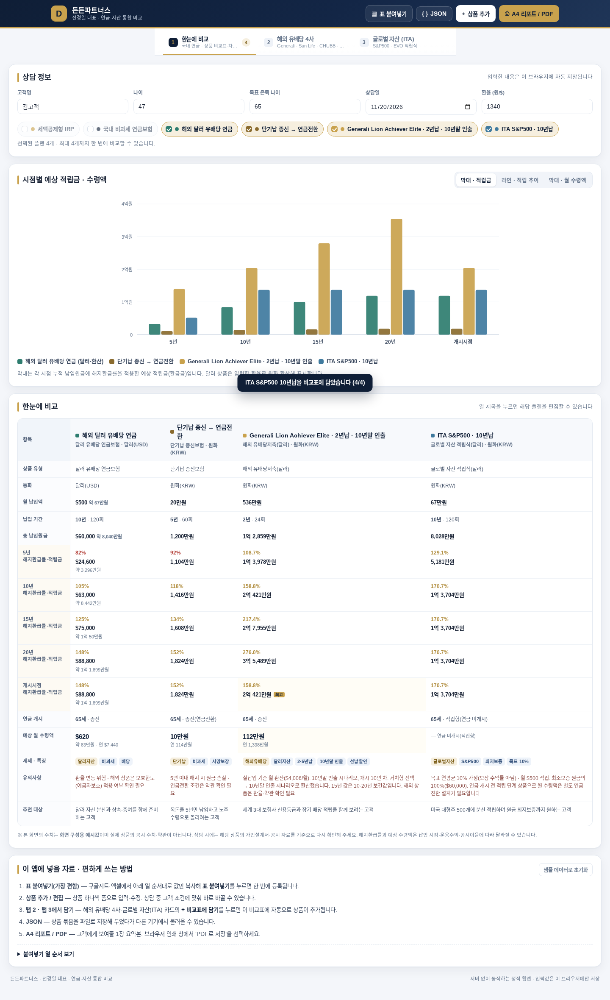
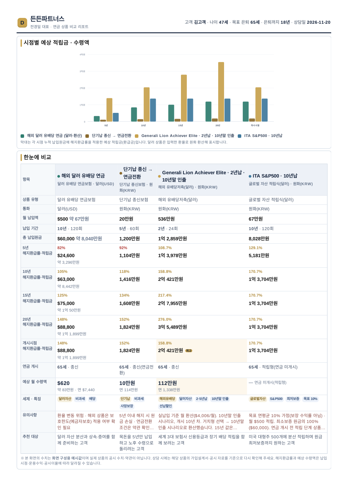

# 📊 연금·자산 통합 비교 — 든든파트너스 · 전경일 대표

🔗 **바로 열기: <https://ruakun4566.github.io/pension-comparison-app/>**

든든파트너스 **전경일 대표**가 고객 상담 자리에서 **국내 연금·해외 유배당 4사·글로벌 자산(ITA)을 한 화면에서 나란히 비교**하는 정적 웹앱입니다.
서버·DB·회원가입 없이 브라우저에서 바로 열리고, 입력한 내용은 그 브라우저의 `localStorage`에만 저장됩니다.

- **브랜드 톤**: 딥 네이비 `#0F1E36` + 골드 `#C9A24D` + 화이트 카드 (개인 연락처·이메일 미노출)
- **반응형**: 모바일(390px) · 태블릿(834px) · PC(1440px) 확인 완료, 모바일 가로 스크롤 없음
- **의존성 없음**: CDN·차트 라이브러리 없이 순수 HTML/CSS/JS (차트는 직접 그리는 SVG)
- **배포**: 정적 파일 그대로 GitHub Pages

## 3개 탭

| 탭 | 내용 |
| --- | --- |
| **① 한눈에 비교** | 상담 정보 · 플랜 선택(최대 4개) · 시점별 차트 3종(막대/라인/월 수령액) · 비교표 15행 · A4 1장 리포트 · JSON 입출력 · 표 붙여넣기 · 상품 추가/편집 |
| **② 해외 유배당 4사** | Generali · Sun Life · CHUBB · AXA — 정산/역산, 적용 환율(자동·직접), 2년납/5년납, 인출 시나리오(거치/5년말/10년말/20년말), 전액 선납, 분기 프로모션 수정, 4사 카드와 5~50년 경과 표 |
| **③ 글로벌 자산 (ITA)** | ITA S&P500 / ITA EVO — 원화↔달러 자동 환산·빠른 금액, 납입기간, 목표 연평균 수익률 슬라이더(보수적 7%·평균 10%·적극적 15%), 최소보증 비교, 연도별 성장 추이 표·차트 |

### 탭 사이 연동 — `+ 비교표에 담기`

탭 ②③의 각 카드에 있는 **`+ 비교표에 담기`** 를 누르면 그 상품이 탭 ①의 비교표에 자동으로 추가됩니다.

- **탭 ②** → 실납입 평균을 월 환산한 납입액, 5/10/15/20년·개시시점 환급률(선택한 인출 시나리오 기준), 특징 태그, 추천 대상으로 변환
- **탭 ③** → 목표 수익률 기준 연도별 예상자산을 환급률로 환산해 추가 (연금 미개시 적립형으로 표시)
- 비교가 **4개로 가득 차면** 상품은 담아 두고 “탭 ①에서 선택하세요” 토스트로 안내합니다. 같은 조건으로 다시 담으면 중복 없이 최신값으로 갱신됩니다.
- 탭 ②③의 **15년 값은 10·20년 보간값**이며, 그 사실을 유의사항에 함께 적어 비교표에 들어갑니다.

## 계산식 (기존 두 시뮬레이터에서 그대로 이식)

**탭 ② 해외 유배당 4사**

- `IA Levy` = 연 보험료 × 0.1%, 상한 HKD 100 ÷ 7.8 = 약 $12.82
- 프로모션 보너스 = 가입금액 구간별 % → 2차년도(또는 매년) 보험료에서 차감
- 전액 선납 = 잔여 연차 보험료를 선납이자율로 현재가치 할인, 그 차액이 절감액
- AXA = 선납 FPDA 보너스 이자를 **캐시백**으로 지급 → 총 납입액은 그대로
- 해지환급금 = 설계서 기준값(가입금액 10만 달러당) × (총 명목 가입금액 ÷ 10만)
- 환급률 = (잔여환급금 + 인출누적) ÷ 총 실납입액, IRR = 연차별 현금흐름(납입·인출·잔여)의 내부수익률
- 역산 = 목표 원화예산 ÷ 환율을 총 실납입액으로 두고 연간 보험료를 이분법으로 역추적

**탭 ③ 글로벌 자산 (ITA)**

- 적립식 월복리 `FV = 월납입 × ((1+r)ⁿ − 1) / r`, `r = 연 목표수익률 ÷ 12`
- 누적 수익률 = (FV ÷ 누적 납입원금 − 1) × 100
- 최소보증: S&P500 10년납 원금 100% · 15년납 원금 140% / EVO는 최소보증 없음
- 최소 납입: S&P500 월 $200 · EVO 월 $100 (둘 다 $100 단위)

**환율** — `open.er-api.com` USD 기준 환율 × 1.005(카카오뱅크 송해환율 추정)을 자동 적용하고, 실패 시 1,350원을 임시값으로 씁니다. 탭 ②는 자동/직접 입력을 전환할 수 있습니다.

> ⚠️ 탭 ①의 기본 프리셋 4종과 15년 보간값은 **화면 구성용 예시값**입니다.
> 상담 시에는 해당 상품의 가입설계서·공시 자료로 다시 확인해 주세요. 개인정보·실제 고객 정보는 들어 있지 않습니다.

## 데이터 넣는 방법 (탭 ①)

1. **표 붙여넣기** — 구글시트·엑셀에서 아래 열 순서로 복사해 붙이면 한 번에 등록 (탭·쉼표 모두 인식, 머리글 이름으로 열 자동 매칭)

   ```
   플랜명  상품유형  통화  월납입액  납입기간  5년환급률  10년환급률  15년환급률  20년환급률  개시환급률  개시나이  월수령액  태그  유의사항  추천대상
   ```

2. **상품 추가 / 편집** — 폼으로 한 건씩 입력·수정. 표의 열 제목을 누르면 그 플랜이 열립니다.
3. **JSON** — 등록한 플랜 묶음을 파일로 내보내고 다른 기기에서 불러오기.
4. **탭 ②③에서 담기** — 계산 결과를 그대로 비교표로 보내기.

## 화면

| 탭 ① 한눈에 비교 | 탭 ② 해외 유배당 4사 | 탭 ③ 글로벌 자산 (ITA) |
| --- | --- | --- |
|  |  |  |

| 해외 4사 + ITA 통합 비교 | A4 1장 리포트 | 모바일 |
| --- | --- | --- |
|  |  |  |

## 실행

```bash
# 방법 1: index.html 더블클릭 (그대로 열림)
# 방법 2: 로컬 서버
python3 -m http.server 8000
# → http://localhost:8000
```

## 배포 (GitHub Pages)

`main` 브랜치 루트를 그대로 올리면 됩니다(별도 빌드 없음). Settings → Pages → Source `Deploy from a branch` → `main` / `root`.

## 검증

```bash
LD_LIBRARY_PATH=/workspace/scratch/atk-libs/usr/lib/x86_64-linux-gnu \
PLAYWRIGHT_BROWSERS_PATH=/workspace/.cache/ms-playwright python3 test/verify.py
```

- `test/verify.py` — 79개 항목: 3탭 전환 · 탭 ① 기존 기능(차트·표·붙여넣기·JSON·4개 제한·localStorage) · 탭 ② 4사 계산/선납/역산/프로모션 수정 · 탭 ③ ITA 계산/최소보증/최소금액 경고 · `+ 비교표에 담기`(4개 초과 안내 포함) · A4 1장 PDF · 모바일 가로 스크롤 0 · 콘솔 에러 0
- `test/compare_ref.py` — 원본 두 사이트(global-financial-plan·makemoney-cal)를 헤드리스로 띄워 **1,203개 계산값을 1:1 대조** (0건 불일치)
- `test/docs_shots.py` — README·docs 화면 캡처 생성
- 원본 대조군은 `work/extract/ref.json`(작업 공간에만 있고 저장소에는 포함하지 않음)에 있습니다.

## 파일 구성

```
index.html      화면 구조 (3개 탭 + 모달)
styles.css      디자인 · 반응형 · 인쇄(@media print) 스타일
data.js         탭① 프리셋 · 탭② 프로모션 DB/메타 · 탭③ ITA 상품 정의
app.js          탭① 상태·표/차트·모달·TSV/JSON·localStorage + 탭 전환·비교표 담기 API
intl.js         탭② 해외 유배당 4사 계산 엔진·카드 렌더·프로모션 편집
ita.js          탭③ ITA 적립식 계산·요약·성장 차트·비교표 담기
test/           verify.py(전체 검증) · compare_ref.py(원본 대조) · docs_shots.py
docs/           README용 화면 캡처 · A4 리포트 PDF 예시
```
