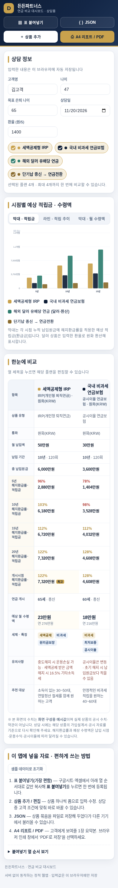

# 📊 연금 비교 대시보드 — 든든파트너스

고객 상담 자리에서 **여러 연금 상품을 한 화면에 나란히 놓고 비교**하는 정적 웹앱입니다.
서버·DB·회원가입 없이 브라우저에서 바로 열리고, 입력한 내용은 그 브라우저의 `localStorage`에만 저장됩니다.

- **브랜드 톤**: 딥 네이비 `#0F1E36` + 골드 `#C9A24D` + 화이트 카드
- **반응형**: 모바일(390px) · 태블릿(834px) · PC(1440px) 모두 확인 완료
- **의존성 없음**: CDN·폰트·차트 라이브러리 없이 순수 HTML/CSS/JS (차트는 직접 그리는 SVG)
- **배포**: 정적 파일 그대로 GitHub Pages / 어떤 웹호스팅에나 올릴 수 있음

> ⚠️ 기본 프리셋 4종의 수치는 **화면 구성용 예시값**입니다. 실제 상품의 공시 수치·약관이 아니며,
> 상담 시에는 해당 상품의 가입설계서·공시 자료로 다시 확인해야 합니다. 개인정보·실제 고객 정보는 들어 있지 않습니다.

## 화면 구성

| 영역 | 내용 |
| --- | --- |
| 상담 정보 | 고객명 · 나이 · 목표 은퇴 나이 · 상담일 · 환율(원/$) — 인쇄 머리말에 그대로 반영 |
| 플랜 선택 | 등록된 플랜을 칩으로 켜고 끄기, **최대 4개 동시 비교** |
| 시점별 차트 | 5년 · 10년 · 15년 · 20년 · 개시시점의 예상 적립금 (막대 / 라인 / 월 수령액 막대 3가지 보기) |
| 한눈에 비교 | 상품유형·통화, 월 납입액, 납입기간, 총 납입원금, 시점별 해지환급률과 예상 적립금, 연금 개시 나이·수령 방식, 예상 월 수령액, 세제·특징 태그, 유의사항, 추천 대상 |
| 리포트 | `A4 리포트 / PDF` — 헤더·차트·비교표·고지문이 **A4 1장**에 들어가도록 만든 인쇄 전용 스타일 |

## 데이터 넣는 방법 3가지

1. **표 붙여넣기** (가장 빠름) — 구글시트·엑셀에서 아래 열 순서로 복사해 `표 붙여넣기`에 붙이면 한 번에 등록됩니다.
   탭(TSV)·쉼표(CSV) 모두 인식하고, 머리글 이름을 보고 열을 알아서 맞춥니다.

   ```
   플랜명  상품유형  통화  월납입액  납입기간  5년환급률  10년환급률  15년환급률  20년환급률  개시환급률  개시나이  월수령액  태그  유의사항  추천대상
   ```

2. **상품 추가 / 편집** — 폼으로 한 건씩 입력·수정. 표의 열 제목을 누르면 그 플랜이 바로 열립니다.

3. **JSON** — 등록한 플랜 묶음을 파일로 내보내고 다른 기기에서 그대로 불러올 수 있습니다.

계산 규칙: `예상 적립금 = 누적 납입원금 × 해지환급률`, 개시시점은 총 납입원금 기준입니다.
달러 상품은 상단에 입력한 환율로 원화 환산액을 함께 보여줍니다.

## 화면

| PC | 모바일 | A4 리포트 |
| --- | --- | --- |
|  |  |  |

## 실행

```bash
# 방법 1: index.html 더블클릭 (그대로 열림)
# 방법 2: 로컬 서버
python3 -m http.server 8000
# → http://localhost:8000
```

## 배포 (GitHub Pages)

저장소 Settings → Pages → Source를 `Deploy from a branch` → `main` / `root`로 지정하면
`https://<계정>.github.io/<저장소>/` 에서 바로 열립니다. 별도 빌드 과정이 없습니다.

## 검증

`test/verify.py` 는 헤드리스 Chromium으로 실제 화면을 열어 31개 항목을 확인합니다.
(초기 렌더 · 표 계산값 · 차트 3종 · 모달 추가/편집 · 표 붙여넣기 파싱 · localStorage 유지 ·
JSON 내보내기 · 4개 선택 제한 · 인쇄 스타일 · A4 1장 PDF · 모바일 가로 스크롤 · 콘솔 에러)

```bash
python3 -m http.server 8765 &
pip install playwright && playwright install chromium
python3 test/verify.py     # 31 checks, 0 failed
```

## 파일 구성

```
index.html      화면 구조
styles.css      디자인 · 반응형 · 인쇄(@media print) 스타일
app.js          상태 · 표/차트 렌더링 · 모달 · TSV/JSON · localStorage
data.js         기본 샘플 프리셋 4종 (예시 수치)
test/verify.py  브라우저 자동 검증 (실행하면 screenshots/ 에 캡처 생성)
docs/           README용 화면 캡처 · A4 리포트 PDF 예시
```
